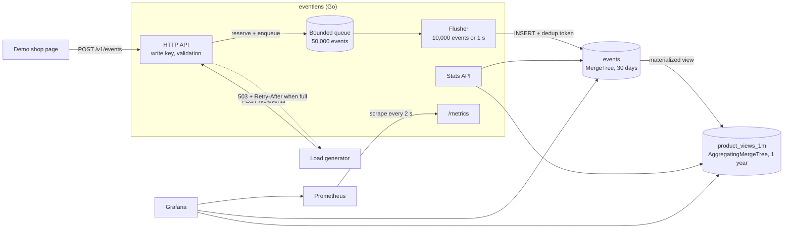

# EventLens

Event analytics for an online shop. A Go collector receives click events (page views, product views, add to cart,
checkout, purchase) at thousands per second, batches them into ClickHouse and answers questions such as "most viewed
products in the last hour" or "how many sessions that viewed a product went on to buy" in milliseconds. Grafana
dashboards show the shop and the health of the pipeline live.

## What it includes

- **Collector API** with a write key, validation of every event and all-or-nothing requests of up to 500 events.
- **Batching** through a bounded in-memory queue: one insert per second (or per 10,000 events) instead of one per
  request, so ClickHouse writes few large parts.
- **Backpressure**: when ClickHouse is down the queue fills and the collector answers `503` with `Retry-After`
  instead of growing or dropping events. Failed batches are retried with the same deduplication token, so a retry
  after a lost answer is stored once.
- **ClickHouse schema** designed for the queries: monthly partitions, `(event_type, occurred_at)` sorting key,
  `LowCardinality` columns, 30-day TTL on raw events.
- **Per-minute rollup** filled by a materialized view (`countState` / `uniqState`), kept for a year and backfilled
  on first start.
- **Stats API** for top products, the purchase funnel (`windowFunnel`) and active sessions.
- **Load generator** that plays realistic sessions (Zipf product popularity, funnel drop-off) and honours `503`.
- **Grafana dashboards as code**: a shop dashboard on ClickHouse and a pipeline dashboard on Prometheus metrics.
- **Demo shop page** that sends events as you click.
- **Benchmark** that loads the same 20 million events into PostgreSQL and ClickHouse and compares them.
- Tests against a real ClickHouse (testcontainers-go), fake clocks for timing logic, CI on every push.

## Stack

| Part | Choice |
|---|---|
| Language | Go 1.27, standard library HTTP server |
| Analytics database | ClickHouse 26.8 LTS, official `clickhouse-go/v2` client (native protocol) |
| Metrics and dashboards | Prometheus 3, Grafana 13 with the official ClickHouse data source |
| Benchmark baseline | PostgreSQL 18 |
| Tests | Go `testing`, testcontainers-go |
| CI | GitHub Actions: gofmt, `go vet`, `go test -race` |

## Architecture



## Repository layout

| Path | What lives there |
|---|---|
| `cmd/eventlens` | Collector entry point: config, ClickHouse, pipeline, HTTP server, graceful shutdown |
| `cmd/loadgen` | Load generator |
| `cmd/bench` | PostgreSQL vs ClickHouse benchmark |
| `internal/event` | Event type and validation rules |
| `internal/ingest` | Bounded queue, flusher, retries |
| `internal/store` | ClickHouse access, migrations (`migrations/*.sql`), stats queries |
| `internal/httpapi` | Handlers, problem+json errors, demo page |
| `internal/metrics` | Prometheus metrics |
| `internal/loadgen`, `internal/bench` | Session generator, sender, benchmark targets |
| `internal/chtest` | Test helper: one ClickHouse container per package, a fresh database per test |
| `deploy/` | Prometheus config, Grafana data sources and dashboards |
| `docs/adr` | Architecture decision records |

## Run locally

Requires Docker. Go 1.27 is only needed to run from source.

**Everything in containers:**

```
docker compose --profile app up -d --build --wait
docker compose --profile load run --rm loadgen -rate 3000 -duration 2m
```

**Collector from source** (for development):

1. Start ClickHouse, Prometheus and Grafana: `docker compose up -d --wait`
2. Start the collector; it applies the migrations on start:
   ```
   $env:EVENTLENS_WRITE_KEY = "dev-write-key"   # PowerShell; on Linux/macOS: export EVENTLENS_WRITE_KEY=dev-write-key
   go run ./cmd/eventlens
   ```
3. Send load: `go run ./cmd/loadgen -rate 3000 -duration 2m`

Then open:

| URL | What |
|---|---|
| `http://localhost:8080/demo` | Demo shop: click and watch the events arrive |
| `http://localhost:3000` | Grafana (no login, local use only): **EventLens - Shop** and **EventLens - Pipeline** |
| `http://localhost:8080/v1/stats/funnel` | Stats API |
| `http://localhost:9090` | Prometheus |

Prometheus scrapes `host.docker.internal:8080`, which reaches the collector either way: run from source, or in its
container through the published port. Grafana downloads the ClickHouse data source plugin on its first start, so it
needs internet access once.

## Demos

**Backpressure.** While the load generator runs, stop ClickHouse for 15 seconds and watch the Pipeline dashboard:

```
docker compose stop clickhouse
docker compose start clickhouse
```

Written events drop to zero, the queue fills up to its capacity, `queue_full` rejections appear and the load
generator waits and retries. When ClickHouse is back the backlog is written, and the number of events in ClickHouse
equals the number the load generator says were accepted.

**Batching.** Every insert creates a part on disk. Compare parts created with the number of requests:

```
docker compose exec clickhouse clickhouse-client --user eventlens --password eventlens -d eventlens -q "SYSTEM FLUSH LOGS"
docker compose exec clickhouse clickhouse-client --user eventlens --password eventlens -d eventlens -q "SELECT count() FROM system.part_log WHERE table = 'events' AND event_type = 'NewPart' AND event_time > now() - INTERVAL 1 MINUTE"
```

At 3,000 events per second (15 requests per second) the collector creates about one part per second.

## API

### `POST /v1/events`

Header `X-Write-Key`, body of 1 to 500 events:

```json
{
  "events": [
    {
      "event_id": "0193b4c2-7d1e-7a3b-9c4d-5e6f7a8b9c0d",
      "type": "product_view",
      "occurred_at": "2026-11-25T18:00:00Z",
      "session_id": "s-1",
      "product_id": "p-42",
      "category": "shoes",
      "country": "TR",
      "device": "mobile",
      "url": "/products/p-42"
    }
  ]
}
```

| Status | When |
|---|---|
| 202 | All events queued, body `{"accepted": n}`. They reach ClickHouse within about a second. |
| 400 | Bad JSON, no events, more than 500, or any invalid event (problem+json lists each one; none are stored) |
| 401 | Missing or wrong `X-Write-Key` |
| 413 | Body larger than 1 MiB |
| 503 | The queue is full (for example while ClickHouse is down); retry after `Retry-After` seconds |

Event types: `page_view`, `product_view`, `add_to_cart`, `checkout_start`, `purchase`. `product_id` is required for
all but `page_view`, `price` (in kuruş) for `purchase`. `occurred_at` may be at most 5 minutes in the future and 24
hours in the past; the server adds `received_at`.

### Stats

No write key needed; meant for dashboards on a private network.

| Endpoint | Default window | Answer |
|---|---|---|
| `GET /v1/stats/top-products?window=1h&limit=10` | `1h` | products by views with distinct visitors, from the per-minute rollup |
| `GET /v1/stats/funnel?window=24h` | `24h` | sessions per step (view, cart, checkout, purchase) in order within one hour, with conversion rates |
| `GET /v1/stats/active-users?window=5m` | `5m` | distinct sessions with any event |

`window` takes Go durations (`15m`, `2h`) or days (`7d`), from 1 minute to 30 days.

### Other

`GET /health` (pings ClickHouse, `503` when it does not answer), `GET /metrics` (Prometheus), `GET /demo`.

## Load generator

| Flag | Default | Meaning |
|---|---|---|
| `-rate` | `2000` | events per second |
| `-batch` | `200` | events per request (max 500) |
| `-workers` | `8` | requests in flight |
| `-products` | `200` | products in the shop; popularity follows a Zipf distribution |
| `-duration` | `0` | stop after this long, `0` runs until Ctrl+C |
| `-key` | `$EVENTLENS_WRITE_KEY` | write key |
| `-url` | `http://localhost:8080` | collector |

## Benchmark: PostgreSQL vs ClickHouse

`cmd/bench` loads the same 20 million synthetic events into PostgreSQL (with an index on `(event_type, occurred_at)`)
and into ClickHouse, checks that both answer four analytical queries identically, and reports load time, disk size
and the median query time:

```
docker compose --profile bench up -d --wait
go run ./cmd/bench -out docs/benchmark.md
```

Loading takes a few minutes. `-rows` changes the size, `-skip-load` reruns only the queries.

## Configuration

| Variable | Default |
|---|---|
| `EVENTLENS_ADDR` | `:8080` |
| `EVENTLENS_LOG_LEVEL` | `info` (successful requests are logged at `debug`) |
| `EVENTLENS_CLICKHOUSE_ADDR` | `localhost:9000` |
| `EVENTLENS_CLICKHOUSE_DATABASE` | `eventlens` |
| `EVENTLENS_CLICKHOUSE_USER` | `eventlens` |
| `EVENTLENS_CLICKHOUSE_PASSWORD` | `eventlens` |
| `EVENTLENS_WRITE_KEY` | required, no default |
| `EVENTLENS_QUEUE_CAPACITY` | `50000` events (at least 500) |
| `EVENTLENS_BATCH_SIZE` | `10000` events |
| `EVENTLENS_FLUSH_INTERVAL` | `1s` |

## Design decisions

| ADR | Decision |
|---|---|
| [0001](docs/adr/0001-use-clickhouse-for-event-analytics.md) | ClickHouse, a column store, for append-only events and aggregate queries |
| [0002](docs/adr/0002-batch-in-memory-without-a-message-broker.md) | Batch in a bounded in-memory queue instead of Kafka; accept losing the queue on a crash |
| [0003](docs/adr/0003-reject-when-full-and-retry-batches-with-a-token.md) | Reject with `503` when full; retry batches with a deduplication token |
| [0004](docs/adr/0004-precompute-product-views-with-a-materialized-view.md) | Per-minute rollup through a materialized view |

Terms are explained in [GLOSSARY.md](GLOSSARY.md).

## Checks

Tests start throwaway ClickHouse and PostgreSQL containers, so Docker must be running.

```
go vet ./...
go test ./...
```

## Roadmap

- Kafka in front of the collector for zero loss on crashes (the HTTP API stays the same).
- Rate limiting per write key.
- More rollups (revenue per category per hour) and a projection for per-session lookups.
- Replicated ClickHouse cluster.
